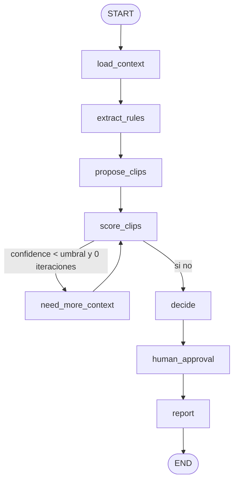

# Shadow LangGraph clip-decider

Grafo que replica el paso clip-decider (`scripts/grok_clip_decider_tick.py`) en
**modo sombra**: misma entrada (asset `transcribed` + transcripción + campaña +
RuleSet), **cero escrituras en BD**. El resultado sale a JSON, nunca a
`candidates` ni a `llm_usage`.

No se instala en la imagen de producción. Dependencias en
`requirements-shadow.txt`.

## Grafo



| Nodo | Qué hace |
| --- | --- |
| `load_context` | Asset, segmentos, campaña, duración. Solo lecturas. |
| `extract_rules` | Reutiliza `rules.runtime` (`ruleset`, `decider_brief`, `duration_window`). |
| `propose_clips` | LLM con salida Pydantic (`ProposedClip`). Sin LLM/key: heurística. |
| `score_clips` | Score 0–1 + checks: duración en ventana, hook, `verifier.check_copy`. |
| `need_more_context` | Arista condicional. Máximo 1 iteración. Lee candidatos de otras campañas. |
| `decide` | 0–`decider.top_n` clips (default 8) o `none` con motivo. |
| `human_approval` | `interrupt()` si CPM × vistas (o presupuesto) > `SHADOW_APPROVAL_THRESHOLD`. En sombra no espera: deja `"habría pedido aprobación"`. |
| `report` | JSON en el estado. Nunca `commit`/`flush`. |

## Cómo ejecutarlo

```bash
pip install -r requirements.txt -r requirements-shadow.txt
# Fixtures locales (por defecto; no toca BD):
python scripts/shadow_decider.py --limit 5
# BD de prueba únicamente (nombre *_test o test_*):
python scripts/shadow_decider.py --from-db --limit 5
```

Salida: `reports/shadow/<fecha>.jsonl` y `reports/shadow/<fecha>.md`.

Flags: `--asset-id`, `--out`, `--mock-llm` (implícito si no hay `XAI_API_KEY`).

Umbrales por entorno: `SHADOW_APPROVAL_THRESHOLD` (USD, default 50),
`SHADOW_CONFIDENCE_THRESHOLD` (default 0.55), `SHADOW_ESTIMATED_VIEWS` (default 10000).

## Informe

Cada línea JSONL compara el decider actual (prompt+parse, sin escribir) y el grafo:

- ventanas (IoU medio del matching greedy)
- títulos
- número de clips
- coste LLM y latencia

Ejemplo en `reports/shadow/example.md`.

Mission Control (solo lectura): `#/shadow` lista ejecuciones y `#/shadow/:id` el detalle lado a lado.
`GET /mission-control/shadow/runs` lee los JSONL del disco; no crea tablas.

## Tests

```bash
pytest tests/shadow tests/services/test_decider_hook.py -q
```

`tests/shadow` lleva el marker `no_db` solo en esa carpeta y no abre sesión. Un test lee el árbol
`app/shadow` y falla si aparece `commit`, `flush` o `approve_candidate`.
